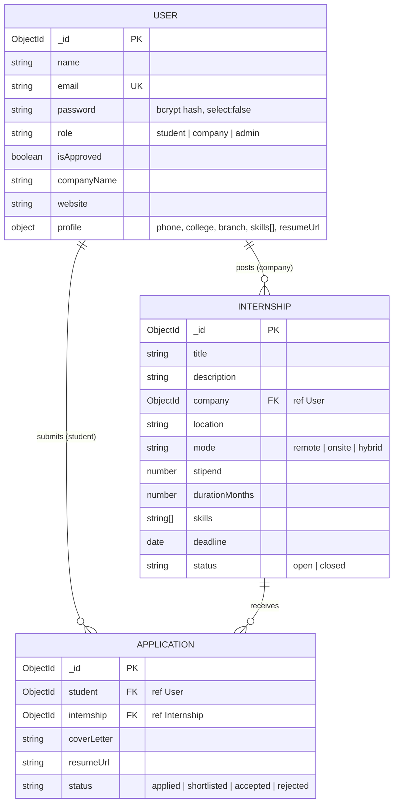

# Database Schema (MongoDB / Mongoose)

## Indexes (database optimization)
| Collection | Index | Purpose |
|---|---|---|
| User | `email` (unique) | login lookup, duplicate prevention |
| User | `{ role, isApproved }` | admin filtering, pending-approval count |
| Internship | `{ status, deadline }` | public listing (open + not expired, sorted by deadline) |
| Internship | `{ company }` | company's own listings |
| Internship | text on `title, skills, location` | keyword search |
| Application | `{ student, internship }` unique | one application per student per internship |
| Application | `{ internship, status }` | applicants list / status counts |

## Aggregation pipelines
`GET /api/admin/stats` uses `aggregate()` with `$group`, `$sort`, `$limit`, `$lookup`, `$unwind`, `$project` to compute users by role, applications by status, most-applied internships and top companies. `GET /api/internships/mine` uses `$group` to attach applicant counts.
